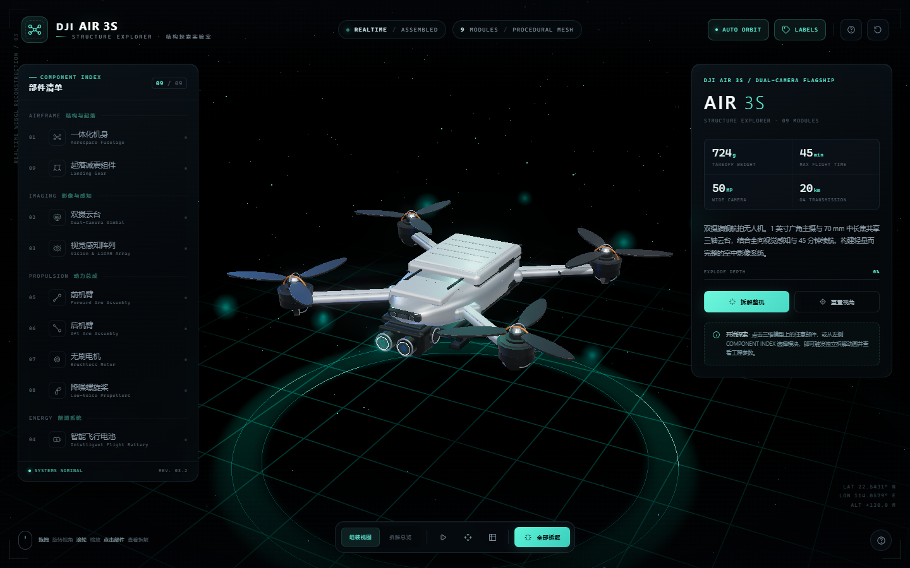
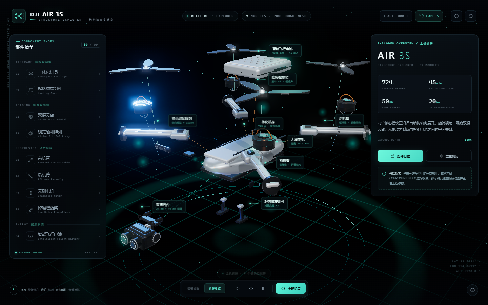
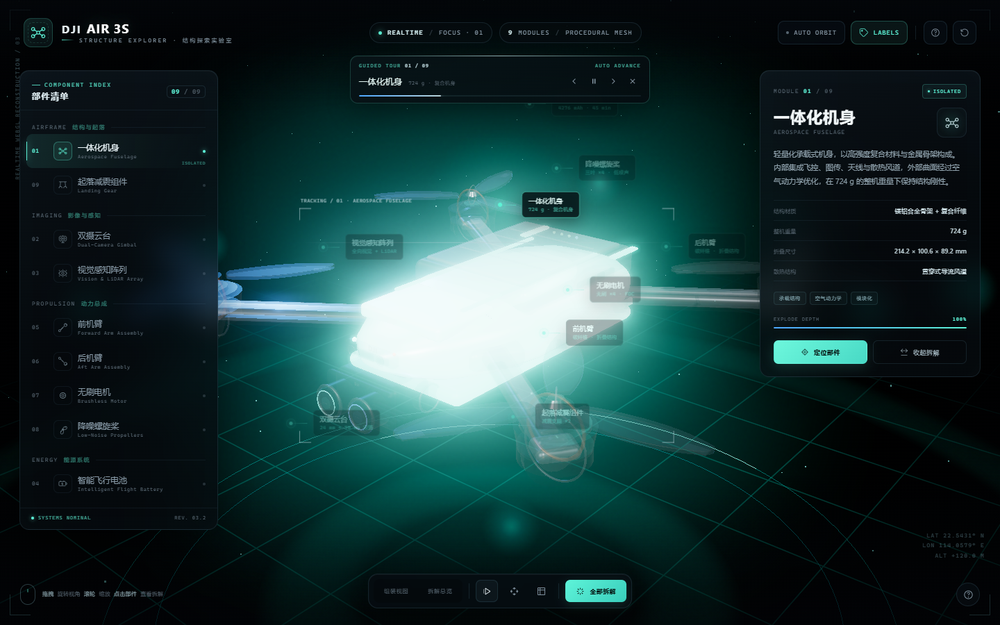

# DJI Air 3S · 结构探索实验室

一个完全由代码生成的 DJI Air 3S 三维拆解可视化页面。所有机身、云台、镜头、机臂、电机、桨叶、电池与起落架模型均由 Three.js 几何体在运行时构建，不加载任何外部 3D 模型或图片资源。







## 运行

方式一：直接双击 `index.html`。页面已打包为单文件脚本，可通过 `file://` 直接打开。

方式二：启动本地静态服务：

```bash
npm start
# http://127.0.0.1:4173
```

## 交互

- **拖拽**：环绕观察整机
- **滚轮 / 双指**：缩放视角
- **点击部件**：独立拆解该模块，其余结构自动弱化
- **全部拆解**：按顺序展开 9 个模块，进入拆解总览
- **自动导览**：底部播放按钮启动 9 模块逐一聚焦，支持暂停 / 上一步 / 下一步；手动拖拽或选择部件会自动暂停
- **部件清单**：左侧 COMPONENT INDEX 可直接切换模块
- **参数面板**：右侧显示部件介绍、材料、结构与核心参数
- **键盘**：`E` 全部拆解 / 组装 · `R` 重置视角 · `Space` 自动环绕 · `L` 标注开关 · `G` 自动导览 · `← →` 导览步进 · `1—9` 选择模块 · `Esc` 退出聚焦
- **操作指南**：右上角或右下角帮助按钮

## 模块

1. 一体化机身
2. 双摄云台（1 英寸广角 + 70 mm 中长焦）
3. 视觉感知阵列（全向视觉 + 前向 LiDAR）
4. 智能飞行电池
5. 前机臂
6. 后机臂
7. 无刷电机
8. 降噪螺旋桨
9. 起落减震组件

## 技术实现

- Three.js r180，`WebGLRenderer` + PBR 材质 + IBL 环境反射
- 自定义超椭圆放样（superellipse loft）生成流线型机身与封闭端盖
- `RoundedBoxGeometry`、`ExtrudeGeometry`、`CylinderGeometry`、`TorusGeometry` 组合生成全部机械结构
- `RoomEnvironment` 生成程序化环境光照，三点布光 + 柔光接触阴影
- `EffectComposer` + `UnrealBloomPass` 实时泛光
- Raycaster 拾取、独立部件材质高亮 / 幽灵化、分层拆解位移动画
- DOM 空间标注跟随、屏幕投影与自动隐藏
- 镜头自动构图、9 模块自动导览与部件包围框（tracking frame）跟随
- 纯 CSS 深色 HUD、玻璃面板、响应式布局；无图片、无字体、无外部依赖

## 目录

```
index.html          # 页面结构、样式与 UI
app.bundle.js       # 构建产物（Three.js + 应用逻辑，可离线运行）
src/app.js          # 可读源码
scripts/serve.mjs   # 零依赖本地静态服务器
```

## 重新构建

```bash
npm install
npm run build
```

修改 `src/app.js` 后重新构建 `app.bundle.js` 即可。
